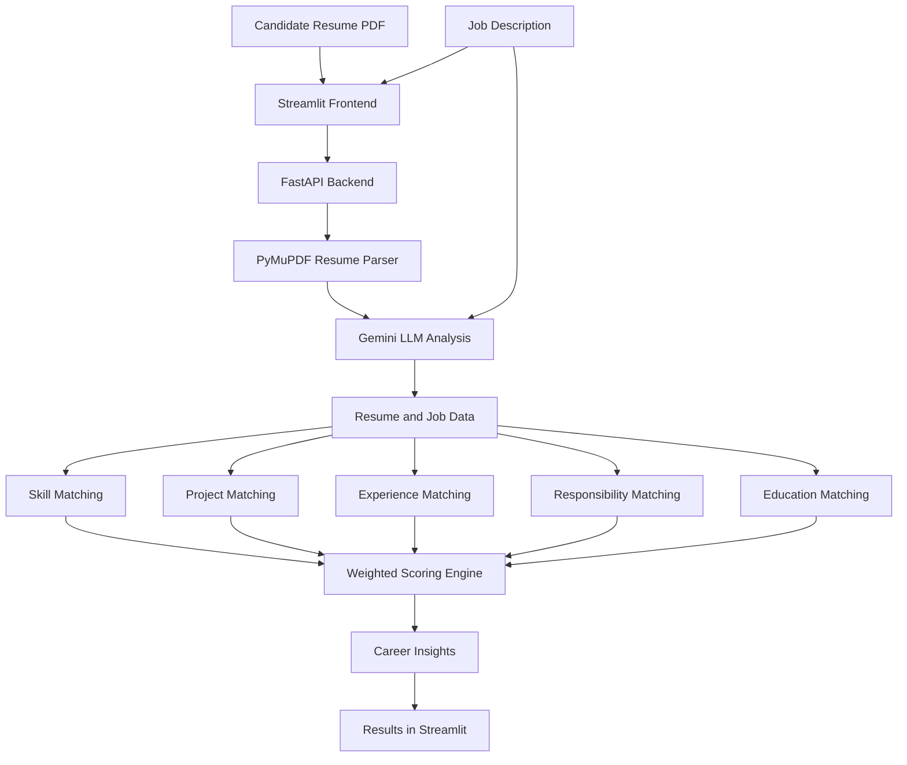

# 🎯 AI CareerPilot
### AI-Powered Resume & Job Match Analyzer

**Analyze your resume. Understand your job fit. Discover opportunities to improve.**

AI CareerPilot is an AI-powered application that compares a candidate's resume with a target job description. It uses Large Language Models (LLMs) and a Python-based scoring engine to evaluate skills, projects, professional experience, responsibilities, and education.

The goal is to help job seekers understand how their profiles align with job requirements and identify areas where they may need to improve.

<p align="center">
  
  
  
  
  
</p>

---

## 📌 Table of Contents

- [Overview](#-overview)
- [Key Features](#-key-features)
- [How It Works](#-how-it-works)
- [System Architecture](#-system-architecture)
- [Scoring Methodology](#-scoring-methodology)
- [Technology Stack](#-technology-stack)
- [Project Structure](#-project-structure)
- [Getting Started](#-getting-started)
- [API Documentation](#-api-documentation)
- [Example Use Case](#-example-use-case)
- [Limitations](#-limitations)
- [Roadmap](#-roadmap)
- [Author](#-author)

## 🚀 Overview

Finding the right job involves more than matching keywords on a resume. Candidates need to demonstrate relevant skills, projects, experience, and evidence that they can perform the responsibilities of a role.

AI CareerPilot brings these dimensions together in one application.

Users provide a PDF resume and a job description. The application extracts resume information, analyzes job requirements, evaluates candidate-to-job alignment, and generates a structured report with an overall match score, category scores, matched skills, potential skill gaps, and career insights.

### 🎯 Project Objectives

- Automate resume and job-description analysis.
- Evaluate more than just keyword overlap.
- Connect project experience with job requirements.
- Identify potential skill gaps and relevant evidence.
- Demonstrate how generative AI can be integrated into a practical full-stack application.

## ✨ Key Features

### 📄 1. PDF Resume Parsing
- Accepts PDF resumes.
- Extracts readable text using PyMuPDF.
- Uses AI to identify structured resume information, including skills, education, experience, projects, and certifications.

### 🧠 2. AI-Powered Job Description Analysis
Uses Google Gemini to extract and interpret:
- Job title and required skills.
- Preferred or additional skills.
- Experience requirements.
- Job responsibilities.
- Relevant project requirements.

### 🛠️ 3. Skills Matching
- Compares listed resume skills with required job skills.
- Identifies matched and missing required skills.
- Provides a basis for understanding technical alignment with the role.

### 💼 4. Project Relevance Analysis
- Evaluates candidate projects against job-related requirements.
- Produces project relevance scores and supporting explanations.
- Helps surface practical project evidence relevant to a target position.

### 📊 5. Experience and Responsibility Analysis
- Evaluates the relevance of professional experience.
- Assesses evidence related to the target role's responsibilities.
- Helps identify areas where the resume may need stronger evidence.

### 🎓 6. Education and Certification Analysis
- Compares education and certification information with job requirements.
- Provides an additional dimension of candidate-role alignment.

### 📈 7. Weighted Match Scoring
Calculates an overall match score using five weighted categories, combining matching results into a single summary indicator.

### 💡 8. Career Insights
Generates structured insights highlighting:
- Relevant strengths.
- Missing required skills.
- Responsibilities with limited supporting evidence.
- Potential areas for improvement.

### 🖥️ 9. Interactive Web Interface
A Streamlit frontend communicates with a FastAPI backend to provide an interface for uploading resumes, entering job descriptions, and reviewing analysis results.

## ⚙️ How It Works

1. **Upload:** The candidate uploads a PDF resume.
2. **Enter:** The candidate pastes a target job description.
3. **Extract:** PyMuPDF extracts readable resume text.
4. **Analyze:** Google Gemini analyzes the resume and job requirements.
5. **Match:** Dedicated Python services evaluate skills, projects, experience, responsibilities, and education.
6. **Score:** The scoring engine calculates category scores and the overall weighted score.
7. **Review:** The application returns matching results, strengths, and potential skill gaps through the frontend.

## 🏗️ System Architecture



*Architecture illustrates the intended end-to-end workflow. Exact execution order and service boundaries may evolve as the project develops.*

## 📊 Scoring Methodology

AI CareerPilot currently uses the following weighted scoring model:

| Matching Category | Weight |
|---|---:|
| Technical skills | 35% |
| Projects | 30% |
| Experience | 20% |
| Responsibilities | 10% |
| Education | 5% |
| **Total** | **100%** |

The overall score is calculated as:

**Overall Score =**

`(Skills × 0.35) + (Projects × 0.30) + (Experience × 0.20) + (Responsibilities × 0.10) + (Education × 0.05)`

Each category is represented on a 0–100 scale.

### Important interpretation

The overall score is a heuristic indicator of resume-to-job alignment. It is **not** a validated probability of getting an interview or a job offer.

Scoring reliability depends on the quality of the extracted information, AI-generated matches, and requirement-level validation. Improving consistency and reducing over-crediting of weak project matches are ongoing development priorities.

## 🧰 Technology Stack

| Technology | Purpose |
|---|---|
| Python | Application logic and matching services |
| FastAPI | Backend REST API |
| Streamlit | Interactive frontend |
| Google Gemini API | Resume and job-description analysis |
| PyMuPDF | PDF text extraction |
| Pydantic | Data models and validation |
| python-dotenv | Environment variable configuration |
| Uvicorn | ASGI application server |
| Git and GitHub | Version control and source hosting |

## 📁 Project Structure

The repository is organized around the backend, matching services, and frontend.

```text
AI_careerpilot/
├── app/
│   ├── main.py
│   ├── models/
│   │   └── schemas.py
│   └── services/
│       ├── llm_service.py
│       ├── resume_parser.py
│       ├── project_matcher.py
│       ├── experience_matcher.py
│       ├── responsibility_matcher.py
│       ├── education_matcher.py
│       ├── score_engine.py
│       ├── career_matcher.py
│       └── career_insights.py
├── data/
├── frontend/
│   └── streamlit_app.py
├── .gitignore
├── Dockerfile
├── requirements.txt
└── README.md
```

*This is the intended structure based on the current development architecture. Check the actual repository if any filenames have changed.*

## 🚀 Getting Started

Follow these steps to run AI CareerPilot locally on Windows.

### Prerequisites

- Python 3.12
- Git
- A Google Gemini API key
- Internet access for Gemini API requests

### 1. Clone the repository

```bash
git clone https://github.com/AlokSarwade2002/AI_careerpilot.git
cd AI_careerpilot
```

### 2. Create a virtual environment

```powershell
python -m venv venv
```

Activate it in PowerShell:

```powershell
.\venv\Scripts\Activate.ps1
```

If you use Command Prompt instead:

```cmd
venv\Scripts\activate.bat
```

### 3. Install dependencies

```bash
python -m pip install -r requirements.txt
```

### 4. Configure the Gemini API key

Create a `.env` file in the project root:

```env
GEMINI_API_KEY=your_gemini_api_key_here
```

Obtain your API key through [Google AI Studio](https://aistudio.google.com/).

Replace the placeholder with your own key.

**Security:** Never commit `.env` or expose your API key in screenshots, logs, source code, or public repositories.

### 5. Start the FastAPI backend

From the project root:

```bash
uvicorn app.main:app --reload
```

The backend should be available at:

`http://127.0.0.1:8000`

### 6. Open API documentation

Visit:

`http://127.0.0.1:8000/docs`

FastAPI's interactive documentation allows you to inspect and test the available endpoints.

### 7. Start the Streamlit frontend

Open a second terminal, navigate to the project root, and activate the same virtual environment.

Run:

```bash
streamlit run frontend/streamlit_app.py
```

Open the local URL displayed in the terminal, typically:

`http://localhost:8501`

You can now upload a resume and enter a job description to try the application.

## 🔌 API Documentation

### Resume and Job Matching

**Endpoint:** `POST /match-job`

The endpoint accepts multipart form data containing:

| Parameter | Type | Description |
|---|---|---|
| `file` | PDF file | Candidate's resume |
| `job_description` | String | Target job description |

Example request using `curl`:

```bash
curl -X POST "http://127.0.0.1:8000/match-job" \
  -F "file=@sample_resume.pdf" \
  -F "job_description=Data Analyst role requiring Python, SQL, and Power BI"
```

The endpoint returns structured matching results. The exact response fields depend on the current API schema and implementation.

For endpoint details and interactive testing, use `/docs`.

## 🧪 Example Use Case

**Scenario:** A candidate wants to apply for a Data Analyst position.

**Input:**
- A PDF resume containing skills, projects, education, and work experience.
- A job description requiring Python, SQL, data cleaning, ETL, dashboards, and reporting.

**Analysis:**
- Extract relevant information from the resume.
- Identify the skills and experience requested by the job.
- Compare projects and responsibilities with those requirements.
- Calculate category scores and an overall match score.
- Highlight relevant evidence and potential gaps.

**Output:**
- Overall match score.
- Skills match and gap analysis.
- Project relevance results.
- Experience and responsibility evidence.
- Education alignment.
- Generated strengths and improvement areas.

Use anonymized or synthetic examples when sharing screenshots or demonstrations publicly.

## 🔐 Security and Privacy

- Store API keys in environment variables.
- Keep `.env` and virtual environments out of version control.
- Avoid committing private resumes, personal data, or confidential datasets.
- Review uploaded files and logging behavior before deploying the application publicly.
- Use synthetic or anonymized candidate data for public demonstrations.

## ⚠️ Current Limitations

AI CareerPilot is an actively developed portfolio project.

- Gemini API quotas can limit analysis requests.
- AI-generated extraction and matching results may be incomplete or inaccurate.
- Project matching requires further validation to prevent over-crediting unrelated requirements.
- Skills demonstrated in projects may not always be reflected in the explicit skills list.
- Experience relevance scores should not be interpreted as verified years of experience.
- The scoring methodology has not been scientifically validated against hiring outcomes.
- Production readiness, deployment, caching, and automated test coverage should be verified before making claims about them.

## 🗺️ Roadmap

- [ ] Improve requirement-level project matching and score validation.
- [ ] Distinguish explicitly listed skills from skills demonstrated through project evidence.
- [ ] Improve experience scoring and evidence quality.
- [ ] Add automated tests for scoring functions and API error handling.
- [ ] Improve Gemini quota handling and reduce unnecessary LLM calls.
- [ ] Implement safe caching for repeated analyses.
- [ ] Refine the Streamlit interface and visualizations.
- [ ] Add verified application screenshots and a demo video.
- [ ] Prepare and validate a secure deployment.
- [ ] Evaluate scoring consistency using representative test cases.

## 👨‍💻 Author

**Alok Sarwade**

AI & Data Science Graduate | Python | Generative AI | Backend Development

- GitHub: [@AlokSarwade2002](https://github.com/AlokSarwade2002)
- Project: [AI_careerpilot](https://github.com/AlokSarwade2002/AI_careerpilot)

## 🤝 Feedback

Suggestions, bug reports, and ideas for improving resume-to-job matching are welcome.

If you find this project interesting, consider starring the repository ⭐.

---

**Built as a hands-on project exploring Generative AI, backend APIs, document processing, and practical career-focused AI applications.**